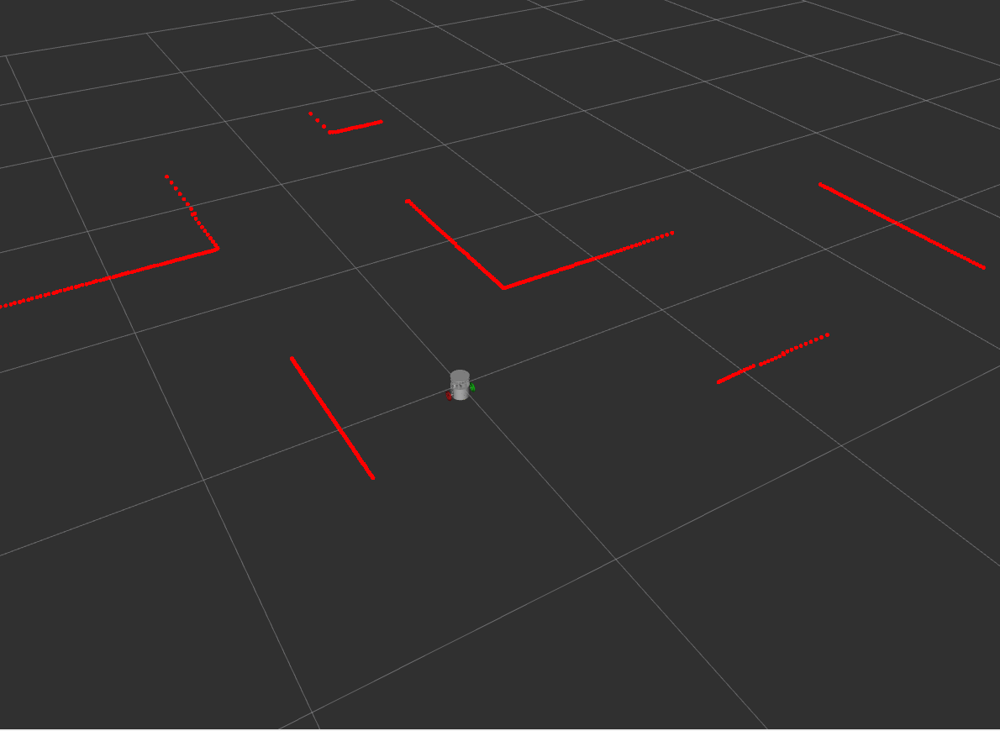

# TP4 Description package

This package is meant to be a base for the TP4. It contains the robot and simulation configuration files.

## [gazebo directory](./gazebo/) 

This directory contains all the simulation configuration files (gazebo sdf files). It also contains a python script to generate random mazes.

### [generate_maze.py](./gazebo/generate_maze.py)

A python script to generate a random maze. When running, the script creates/updates a [tp4_maze.sdf](gazebo/tp4_maze.sdf) file. You can run the script to update the maze and test your algorithm in several environments.

### [ros_gz_bridge.yaml](./gazebo/ros_gz_bridge.yaml)

Configuration file for the bridge between gazebo and ros2 (ros_gz_bridge/parameter_bridge).


### [tp4_ground.sdf](./gazebo/tp4_ground.sdf)

An sdf description of the simulation ground.

### [tp4_light.sdf](./gazebo/tp4_light.sdf)

An sdf description of the simulation light (sun).

### [tp4_maze.sdf](./gazebo/tp4_maze.sdf)

An sdf description of the maze (generated by the python script).

### [tp4_world.sdf](./gazebo/tp4_world.sdf)

An sdf description of the simulation world. It includes the ground, light and maze but also the simulated robot from the urdf file.

## [launch directory](./launch/)

This directory contains the launch files.

### [gazebo_and_rviz_launch.py](./launch/gazebo_and_rviz_launch.py)

This launch file starts (amoung others):
- Gazebo in server mode (withour the user interface to save processing ressources) with the simulated world;
- The gazebo/ros2 bridge
- Rviz

When running this launch file you should have the rviz window with the robot and LiDAR data displayed:



## [meshes directory](./meshes/)

This directory contains the STL 3D models for the simulated robot (the body and the two wheels)

## [rviz directory](./rviz/)

This directory contains the rviz configuration file (to have everything setup at launch).

## [urdf directory](./urdf/)

This directory contains two xacros files and one urdf file. The urdf file has been generated from the xacros files. To generate the urdf file, one can use the command:

```bash
xacro tp4_robot.xacro > tp4_robot.urdf
```

### [tp4_properties_and_macros.xacro](./urdf/tp4_properties_and_macros.xacro)

This xacro file defines macros (to compute inertia matrices), colors and robot parameters (size and weight for instance). This is done to ease the tp4_robot.xacro file.

### [tp4_robot.urdf](./urdf/tp4_robot.urdf)

This description file is generated from the corresponding xacro file.

### [tp4_robot.xacro](./urdf/tp4_robot.xacro)

The xacro description of the robot, with some gazebo tags for the simulation.